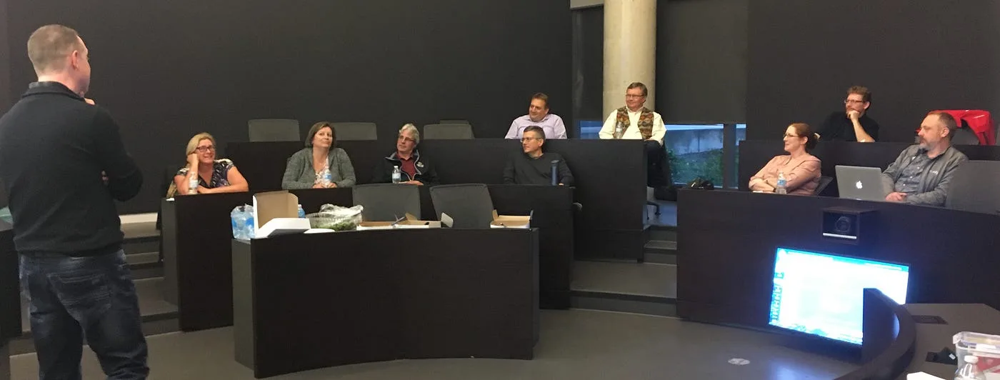
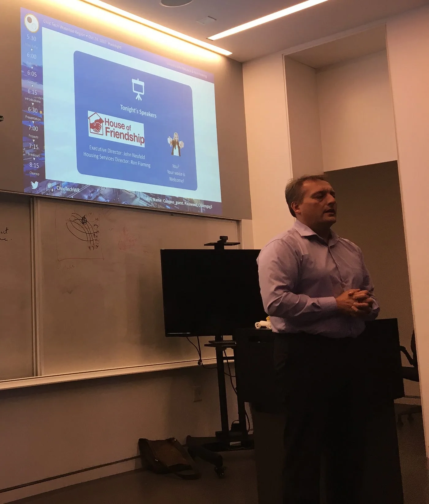

Cross posted from our Medium Account: <https://medium.com/civictechwr/civictechwr-meets-house-of-friendship-ade25aad0414>

Half-round table introductions with some of the attendees

John Neufeld, Ron Flaming and other attendees from the House of Friendship facilitated a fantastic and eye-opening conversation at CivicTechWR’s second meetup on a cold, wet and rainy day in October. We really dug into some details about how the tech community can help [House of Friendship](https://www.houseoffriendship.org/) serve our community and the citizens who are experiencing homelessness, food insecurity and addiction. Not by connecting with our wallets or our hearts, although it was a very emotional evening, but by putting our heads together to put our skills to good use.

<!-- more -->

House of Friendship started in the 1930s, as John states “_one of the original start-ups_”, when a group of women took it upon themselves to start serving meals to the “hobos and transients” of downtown Kitchener. That initial service of meals gradually turned into an overnight shelter, then branched out into providing hampers of food for families in need. In the 1970s and 1980s, House of Friendship started offering things like summer camps for women & children and addiction treatment services, and they built on their services for the homeless by creating supportive housing options and spearheading community development initiatives. The House of Friendship also helped kick-start one of Canada’s most innovative food bank systems.

## Food (In)Security in Waterloo Region

The [Food Bank of Waterloo Region](http://www.thefoodbank.ca/en/) collects food from all kinds of community initiatives and assembles it all in a giant warehouse. From there the food is distributed through 100 [different partner organizations](http://www.thefoodbank.ca/en/aboutus/member_agencies.asp?_mid_=11322) including local shelters, church-based hamper programs, “soup kitchens”, and the House of Friendship. The House of Friendship actually distributes about 60% of the food bank’s food out of their location at 807 Guelph Street. The food bank also supports programs at [St John’s Kitchen](https://www.theworkingcentre.org/st-johns-kitchen/143) & [Ray of Hope](https://www.rayofhope.net/need-help/community-support/). John challenged the audience to experience a life changing meal shared with the many people who visit St John’s. Between these two organizations, people can gather for daily hot meal at lunch and dinner.

## Who’s experiencing food insecurity?

Thanks to technology, the Food Bank system has recently started being able to better use data to understand the community’s needs. It used to be that each distribution centre kept their own records about who was accessing their services. This meant that we didn’t truly have a good understanding of how frequently the same household was in repeat need of the food bank’s help — regardless of which location or service they used to access help.

Now, for the first time in decades, when a member of the community shows up at one of the food distribution centres, their name is in a central database, and we’re starting to get a better understanding of usage patterns. It turns out that most families only rely on the Food Bank’s services a couple of times a year, which is exactly what they want to be there for: emergency help. But there are some very small pockets in neighbourhoods within our region where families are turning to the food bank on a weekly basis. This type of analysis is only possible with a connected system across the region. With more data, maybe we could start to get a picture of the root cause of this food insecurity?

## What does community development look like?

As we mentioned earlier, House of Friendship branched out from its initial service of food to take on community development. Not only do they offer [supportive housing](https://www.houseoffriendship.org/how-we-help/shelter-and-supportive-housing/) options, but they also provide [community centre programs](https://www.houseoffriendship.org/how-we-help/community-centres-and-summer-camp/) in low-income neighbourhoods. These programs include everything from food distribution to cooking groups to homework help to community gardens.

> The tech community can make a real difference by initiating and hosting workshops that teach kids to be producers of technology not just consumers.

As producers, our children will grow up understanding how they can contribute to the evolving society of innovation-rich Waterloo Region. [InkSmith](https://www.inksmith.co/steam) set a good example of one way any of us can contribute to this reality. In partnership with House of Friendship, they ran a workshop at a neighbourhood community centre and gave the kids in that community an opportunity to learn how to use a 3D printer to design, print, and assemble a working plastic car.

3D Printed toy car similar to what InkSmith worked with kids to create during their hosted workshop.

Coding camps, robotics demonstrations and other STEM-focused learning and exposure oriented experiences are other examples of where the tech community has the skills and knowledge and could invest in making a meaningful difference.

## What about central services like the digital lab at KPL?

John also opened up about some of the excellent services and programs offered at central locations like the [Kitchener Public Library](http://www.kpl.org/). Unfortunately, the reality is, for many families, getting kids to and from a central location for an evening or weekend event is neither easy nor cheap. Services offered right in the local neighbourhood are far more accessible for low-income families. You’re not going to send your daughter on her own across town to the KPL, after school. You might be fine with her walking down the block to the community centre, though. Proximity to the need was a common message throughout the evening.

John Neufeld, Executive Director, House of Friendship

## How do you measure success? What’s your goal?

Ultimately, House of Friendship has an ambitious goal: end homelessness. Realistically, this means that they want to get to functional zero homelessness. Think of it like a “zero open defects” policy within software development. Realistically, we’re not going to get to a point where there are no people ever experiencing temporary homelessness, just like we’re never going to produce bug-free software. But it means that the goal is to have the rate where people enter the shelter systems to be equal to the goal where they ‘graduate’ to permanent homes.

Measuring progress toward this goal is currently a gap. Tracking individuals is hard and to some degree, can be an invasion of their privacy. We don’t know what happens to an individual or a family once they’ve made it into a permanent housing situation: do they stay? Do they experience homelessness again? Maybe we can help sift through the data and find a way to measure in aggregate.

## Where’s the data, right now?

Shelters collect information about people who use their services in a federal system called [HIFIS](https://www.canada.ca/en/employment-social-development/programs/communities/homelessness/nhis.html). Up until now, this has been a local system, collecting information from individual shelters. The newest version of this software is now centralized, and, when ready, will presumably be able to show usage patterns between shelters across the region. Right now any of that cross-referencing is done manually by one shelter calling another: “Have you seen Joe this week?”

The individuals accessing these shelters and food services are people. They have stories. Those stories are key to understanding their experiences. Those stories are known by the people serving at House of Friendship, Ray of Hope, St John’s Kitchen, the Working Centre, Reception House, and a myriad of the other social services in our region. Those stories aren’t captured in the information systems and the databases and the reporting… but that quantitative data can help us to understand patterns and try to identify root causes. Is there a job here for an anthropologist to somehow make sense out of that combination of qualitative and quantitative data? Is there a job here for some people who can marry data science, information architecture, and user experience, to help us find those patterns? _“We need you to tell us what’s possible, here!”_ John reiterated. _“We don’t know what we don’t know and you people think differently and could maybe help find solutions.”_

## What does the future look like?

Many of the clients of the shelter system and community programs have basic cellphones…but they’re currently just consumers of this technology. They don’t feel like they’re a part of the tech community. There’s a lot of “us versus them” when it comes to things like all of the big expensive condo developments, shiny new office buildings, and even things like the LRT.

A couple of years ago, a local CEO was quoted as saying,

> “A problem we have in downtown right now is that there are so many social services. […] That has to be addressed.”

Are you kidding me? We’re better than that, right, Waterloo Region?

As inflammatory as the comment was, it did achieve one good thing: to start the conversation about how the growing tech and innovation community can work together to make an inclusive Waterloo Region where **all citizens**can live, work, and feel part of the community.

## What are we going to do?

What if we could set up learning labs in neighbourhoods identified by House of Friendship as having a high concentration of people in need? What if we could stock them up with basic computers (Raspberry Pis?), and maybe some older smartphones? What if we could staff them with some of the awesome developers, makers and other passionate, action-oriented individuals in our region who love mentoring and teaching? What if the kids in these communities didn’t just have access to computers to use them to consume content, but were able to discover just how awesome they could become at making computers and technology DO cool stuff? What if we could get their perspective into the pipeline for technology talent in the future? What could we build, together?

> “The tech sector has a lot of clout. What are you going to do with that?”
>
> — Ron Flaming, Housing Services Director at House of Friendship

Do you want to help figure it out, together? Join our [Meetup group](https://www.meetup.com/preview/CivicTechWR) or follow us on [Twitter](https://twitter.com/civictechwr) to be among the first to get the details for our next event.

---

You can save the date right now, though: See you on November 14 at the Communitech Data Hub in Uptown Waterloo!
