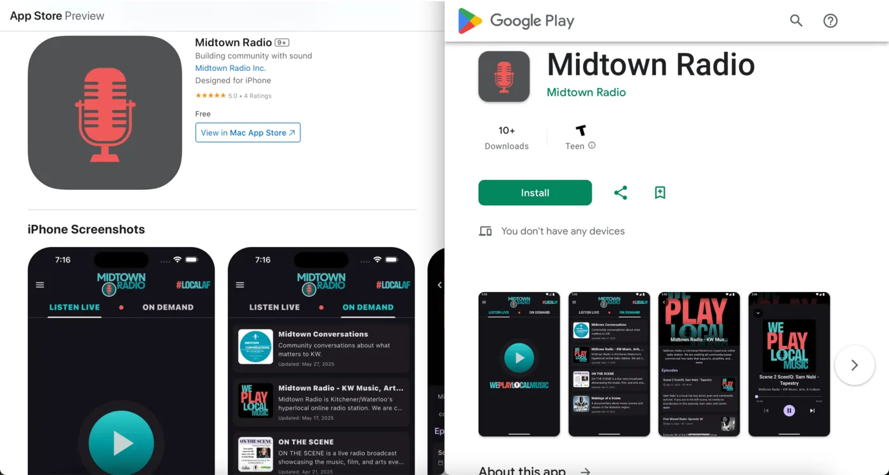
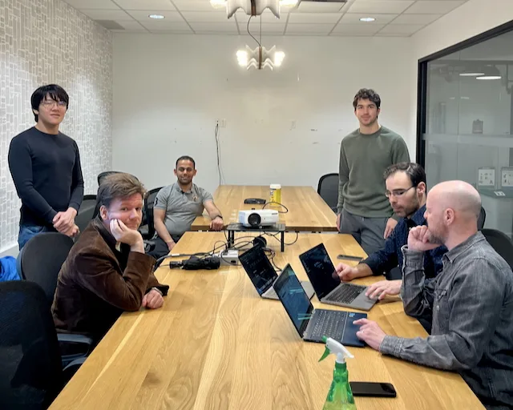

MidTown Radio mobile App was created which provides access to their live stream, podcasts, and artist directory in the Waterloo Region. This app gives [MidTown Radio](https://www.midtownradio.ca/) another way to reach audience and showcase art in the community. The [CBC Listen App](https://www.cbc.ca/listen/live-radio) is an example of what they inspired for.  

## What was the Problem?
There’s no shortage of music streaming platforms. But finding music created by people in your own region, artists playing live sets just down the road, isn’t something those platforms do well. That gap sparked a small, time-bound project this spring: to design and launch a mobile app that helps listeners discover and access music made by local artists.

Twelve weeks later, the app is live on [Apple App Store](https://apps.apple.com/ca/app/midtown-radio/id6746517964) and [Google Play Store](https://play.google.com/store/apps/details?id=com.civitechwr.midtownradio.app.ctwr_midtown_radio_app&pcampaignid=web_share)

The initial conversation wasn’t about building an app. It was about what was missing. Artists were producing music, but not finding local audiences. Listeners were eager to engage with community music, but had no centralized way to find it.

>“There just wasn’t a good place to go to hear locally produced music,” said David Harmes, who led the project. “Commercial radio rarely plays it, and most people don’t know where else to look.”

That mismatch, between what’s being created and what’s being heard, became the basis for a simple goal: build a platform that could bridge that gap, starting with version 1.0.

## People Involved
The group behind the project was made up of volunteers, students from Conestoga, Waterloo, and Guelph, along with working professionals from across the region. Some brought technical expertise. Others contributed production experience, design input, or feedback on usability.

- Cole Westerveld [Github account](https://github.com/coleWesterveld) & [Linkedin Account](https://www.linkedin.com/in/cole-westerveld/)
- Julian Morley [Github account](https://github.com/julianm-lrj) & [Linkedin Account](https://www.linkedin.com/in/julian-morley)
- Justin Chenvanich [Github account](https://github.com/jChenvan) & [Linkedin Account](https://www.linkedin.com/in/justin-chenvanich-1675621b3)
- Andrew Sullivan Cant [Github account](https://github.com/acant) & [Linkedin Account](https://linkedin.com/in/andrewsullivancant)
- Gabriela Niño Ramirez [Github account](https://github.com/gabynr)
- Aditya Mahajan [Github account](https://github.com/aditya-mahajan96) & [Linkedin Account](https://www.linkedin.com/in/adityamahajan263/)
- David Harmes [Linkedin Account](https://www.linkedin.com/in/david-harmes-1aa42634/)

## Technology Used
The timeline was tight: twelve weeks, end to end. They broke the work into stages: interface design, content architecture, platform requirements, deployment. Each task was designed to move the group forward toward a public-ready launch.

One of the biggest hurdles came late in the process, preparing the app for distribution on Apple’s App Store and Google Play.

“I was surprised by the technical and administrative work required just to get it listed,” said Harmes. “It was more complicated than expected. But the team found a way through.”

The technologies the team ended up using were

- Dart & Flutter (the main coding languages used for developing the app)
- Android Studio (for developing the Android app)
- XCode (for developing the iOS app)
- Visual Studio Code (as an IDE to code)
- Git
- Android toolchain

You can checkout the project repo at https://github.com/CivicTechWR/MidtownRadioApp

## Impact on Civic Community
The technical solution wasn’t the full story. What made the build possible was a steady rhythm of collaboration. Weekly planning helped coordinate contributions. The scope stayed realistic. Everyone working on the app, from developers to radio producers, had a role in shaping how it came together.

>“I’m proud of the mix of people who were part of this,” Harmes noted. “It wasn’t just about building an app. It was about working together toward something useful, and doing it in a short, focused window.”

All of the collaborators initially connected through CivicTechWR. While some contributors brought deep technical backgrounds, others were newer to software projects. Several described the experience as a learning opportunity, a way to see the full process of app development, from first meeting to public launch.

## What's Next (Opportunity for Sponsors)
At the spring showcase, version 1.0 of the app was presented as a working product. Visitors were encouraged to test the app, try out its features, and share thoughts on what might come next.

The team will spend the next few months collecting input, monitoring usage, and making adjustments. The roadmap is open-ended: this version is a starting point, not a final product. Future updates may include new ways for artists to share content, better search and discovery tools, or features informed by what listeners say they need.

This was a short, focused project with a clear goal: to make it easier for people to access music being created in their own community. As David Harmes put it, “I think it’s going to be a game-changer for the way people access local music, and connect with musicians who perform live in the community.”

The team, made up of students, professionals, and volunteers loosely organized through CivicTechWR, approached the work with a shared commitment to delivery, not just design. And for many of the non-technical contributors, the project became an opportunity to learn what it takes to build and publish working software, from start to finish.

The app is live on [Apple App Store](https://apps.apple.com/ca/app/midtown-radio/id6746517964) and [Google Play Store](https://play.google.com/store/apps/details?id=com.civitechwr.midtownradio.app.ctwr_midtown_radio_app&pcampaignid=web_share). Feedback is ongoing. The next version will be shaped by what users, both musicians and listeners, say they need.

What’s been built so far is simple. But it answers a real need, and it’s already beginning to shift how local content is discovered and heard.
