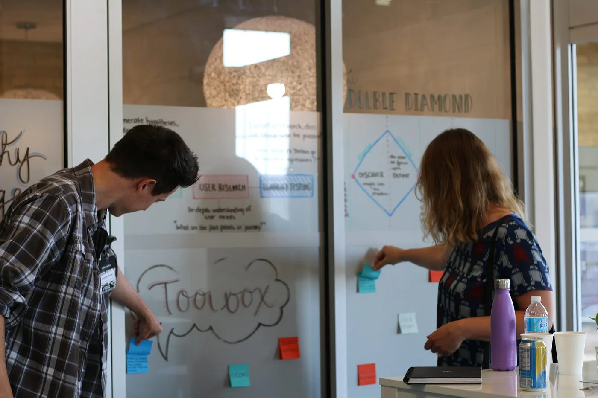
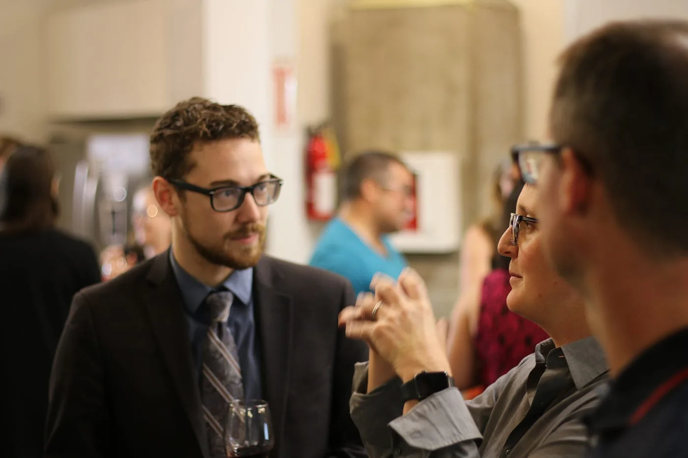
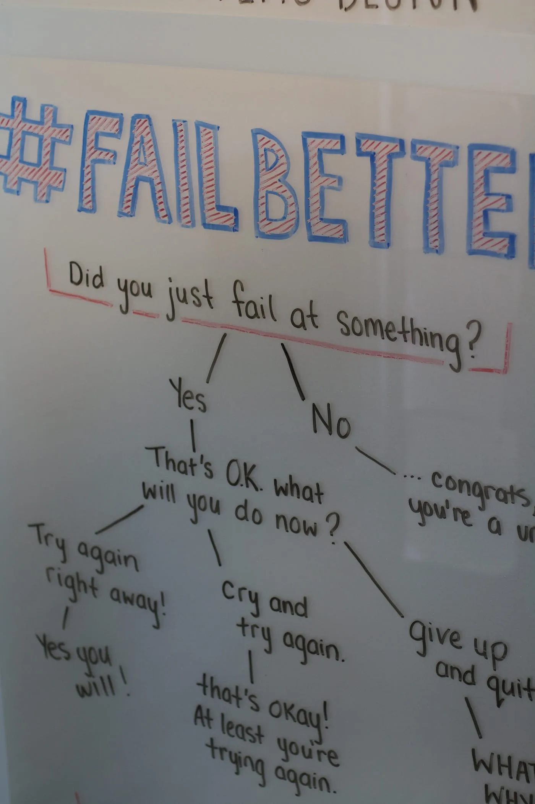

Cross posted from our Medium Account: <https://medium.com/civictechwr/ontario-digital-service-lab-launch-f47b948ff908>

The Ontario Digital Service team opened a [new user research lab](http://news.communitech.ca/news/ontario-government-launches-lab-at-communitech-to-transform-digital-services/) in the Back Alley at Communitech on August 9. The lab’s mandate is to transform the digital services offered by the Government of Ontario. It might sound lofty and vague but, with the right tools and expertise in place, meaningful change is absolutely achievable.

<!-- more -->

The keystone of this new user research lab is the “Empathy Lounge.” This room is designed to look and feel like a living room, because that’s where most people access Ontario’s digital services. You’re sitting at home on the couch, using a laptop, smart phone, or tablet, or maybe you’re at a nearby computer desk, when you’re looking up information about how to sell your car. Or you’re wondering how your 17 year old is going to pay for college. Or you’re thinking about that test your doctor ordered, and wondering what’s going to happen next (and when!).

[Jonathan Tonge](https://medium.com/u/ff3635c0f3a8?source=post_page---user_mention--f47b948ff908---------------------------------------) and [Kristina Taylor](https://medium.com/u/5745c5311dc2?source=post_page---user_mention--f47b948ff908---------------------------------------) check out the Toolbox on the wall of the Empathy Lounge. Photo by Sameer Vasta.

As pictured above, the outside of the Empathy Lounge is essentially a big glass whiteboard, and it’s currently adorned with information about user research and design techniques. The lounge itself has a comfy couch, coffee table, warm lighting — and reasonably unobtrusive video cameras. From video feed, the user research team can remotely observe residents as they try to achieve their goals using Ontario’s current and rapidly improving digital services.

As part of the lab launch, the Ontario Digital Service (ODS) team hosted an “office hours” event in Communitech’s Area 151. This team is led by Ontario’s very first Chief Digital Officer, Hillary Hartley. I won’t try to do justice to [Hillary Hartley](https://medium.com/u/958111e75c23?source=post_page---user_mention--f47b948ff908---------------------------------------) ’s track record here, but she was a 2013 Presidential Innovation Fellow, under the Obama administration, and one of the co-founders of [18F](https://18f.gsa.gov/).

Sebastian _Prins (Office of the Hon. Liz Sandals, MPP) speaking with Hillary Hartley, Chief Digital Officer for Ontario. Photo by Jonathan Tonge.

The ODS team has already launched several projects, even before starting this focused user research lab. For example, at [ontario.ca/osap](http://ontario.ca/osap), prospective and existing students can quickly and easily learn about their options for tuition assistance programs. Even more recently, launched on August 10, [ontario.ca/waittimes](http://ontario.ca/waittimes) and [ontario.ca/health](http://ontario.ca/health) now provide valuable, easy to navigate, and timely information about medical services in the province.

The open house event was successful in launching the ODS initiatives and space within the community and laid the groundwork for the creation of a network of like minded individuals passionate about civic technology. Within this region alone there are several groups and initiatives — from Digital Kitchener and their Innovation Activator Lab to [TriTAG](http://www.tritag.ca/) and some of the initiatives by [HiveWR](http://hivewr.ca/2017/07/24/gentrification-study/).

FailBetter flowchart on the lab wall. Photo by Jonathan Tonge.

One such group looking to be a hub and catalyst in the region is the nascent (stay tuned!) [Waterloo Region Civic Tech](http://civte.ch/) (CTWR) team. A few of the co-founders of the group attended the open house to see the new lab and meet some of the people innovating within the various levels of our government.

One particular feature of the ODS space, the #FailBetter flowchart on the wall of the lab, resonated with the CTWR team as it really embraces the spirit of what they’re working towards.

The CTWR mission is to connect citizens, civic innovators, technologists, community groups, governments, and entrepreneurs with civic tech initiatives. They strive to empower this diverse group to work together, exchange ideas and tools to improve the lives of the residents in and around Waterloo Region through the invention, innovation and evolution of technology.

To reach that goal, over the coming months, the group is going to be trying a few things, seeing what works, probably failing, and trying something different. According to its founders, like everything in life, it is a work-in-progress. You can find more information on the team and the vision at [http://civte.ch](http://civte.ch/).

Both ODS and CTWR, in addition to other similar initiatives across the city, region, province and country, are excellent examples of how government and ordinary citizens are joining forces to solve real world challenges in civic technology.

---

Do you have a message you’d like to share with a group of technology- and civic-minded Waterloo Region citizens? Do you have a space you can offer for an evening to host a speaker and a working session? We’d love to hear from you! The easiest ways to connect are to reach out at [hello@civte.ch](mailto:hello@civte.ch) or find us on [Slack](https://civictechwrslack.herokuapp.com/) or [Twitter](https://twitter.com/civictechwr).
