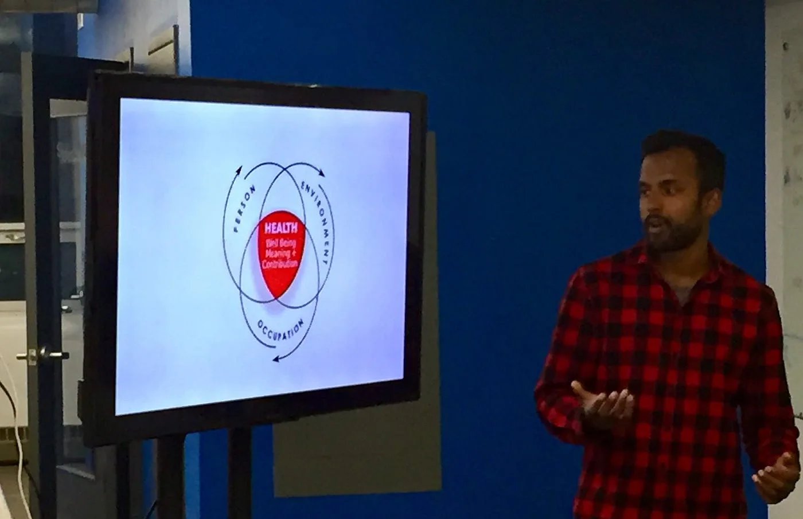
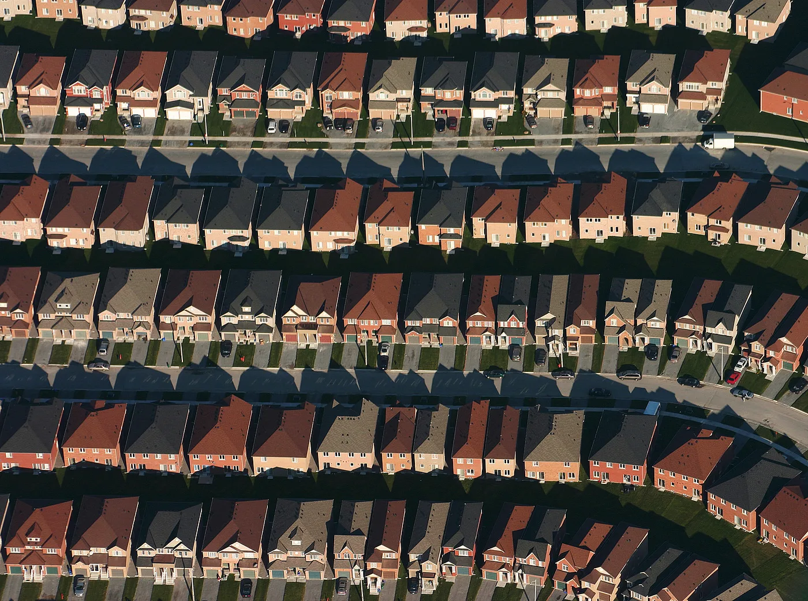
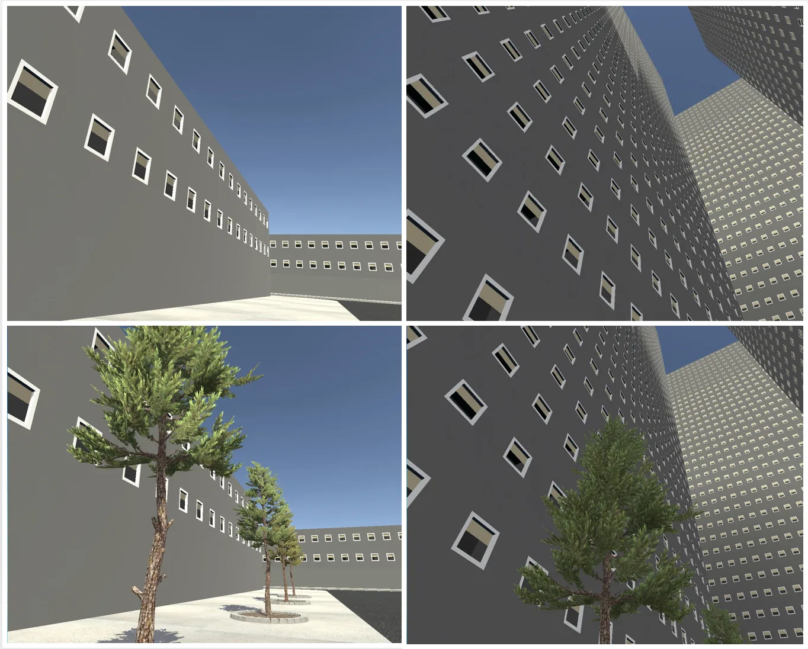
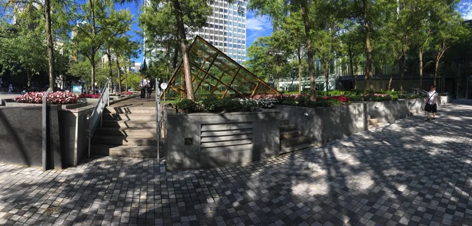
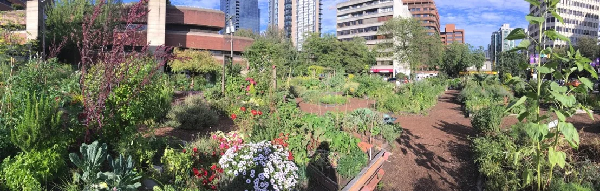
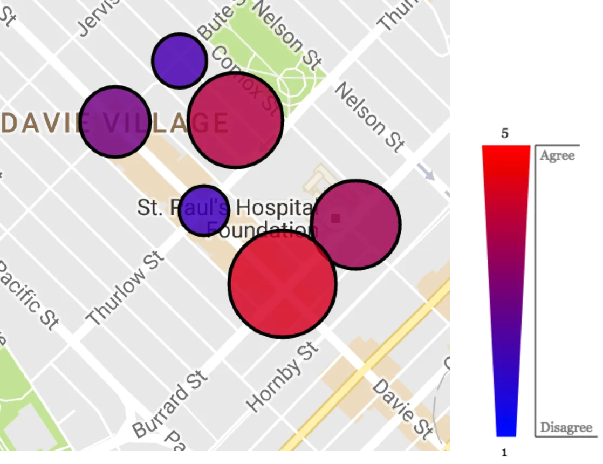
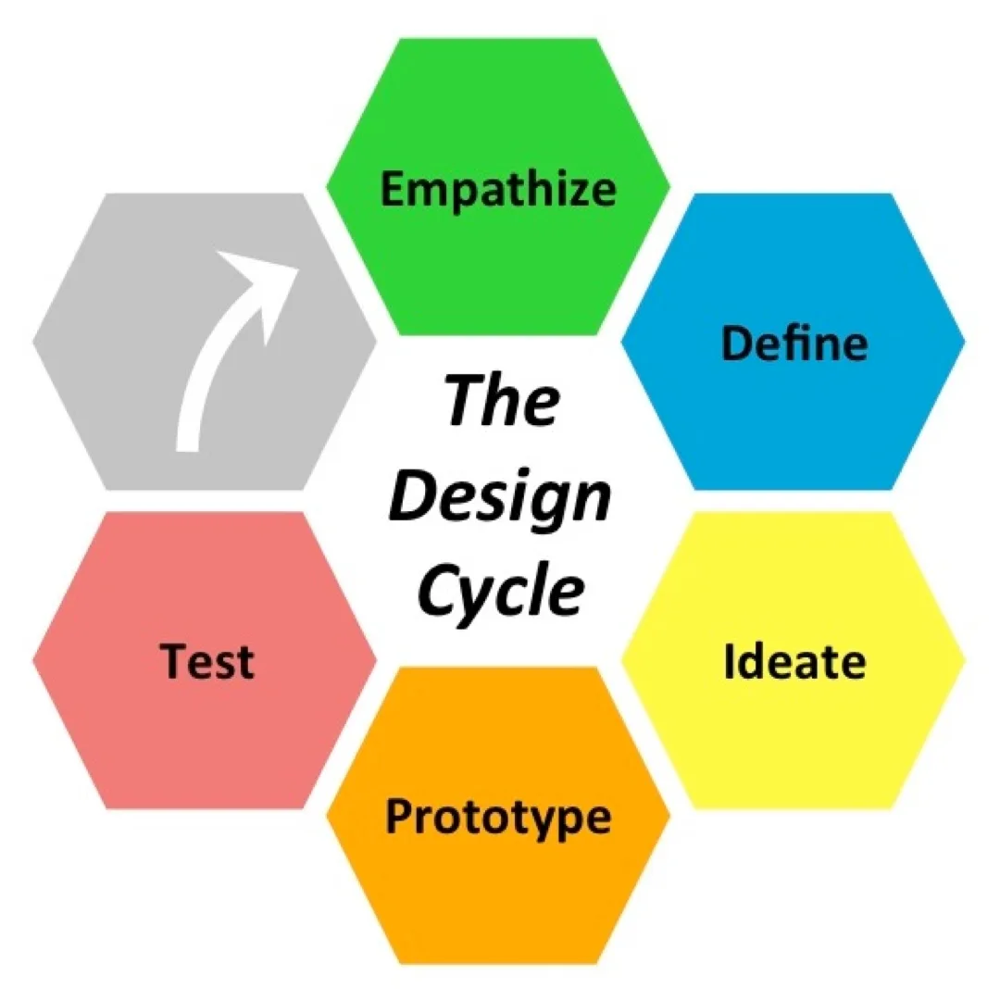

Cross posted from our Medium Account: <https://medium.com/civictechwr/urban-design-happiness-e177132b0a47>

While I feel like saying this about every guest speaker we’ve hosted, for [CivicTech WR](https://medium.com/u/e2a08d065cd3?source=post_page---user_mention--e177132b0a47---------------------------------------)’s February event, we had a special treat. [Robin Mazumder](https://robinmazumder.com/)shared his story with us, and I think it’s safe to say that we all learned a lot about how the design of our cities can impact our health and well-being.

<!-- more -->

## Challenging Assumptions

Robin started his career in Occupational Therapy, working with people with various forms of mental & physical disabilities. The “Person-Occupation-Environment” model is a foundational conceptual model and model of practice in OT. It describes how factors related to the individual are only part of what impacts their health. The situation around them (environment) and what that person does (occupation) both also have a substantial impact on well-being.
> “OT shifted the my understanding from a disabled person to a disabling environment.”

Robin Mazumder, describing the PEO model for health, well-being, meaning & contribution

Disability is a factor of the environment. A friend of mine moved from Kitchener to Toronto a couple of years ago, and went from relying heavily on other people to help him get to work to being able to roll out his front door, onto the subway, and in to work. That’s not to say that his life in Toronto is easy. Between snowbanks, obstructive people, broken elevators, locked doors, subway maintenance, and able-bodied people rushing the elevators, the environment continues to impact his mobility — just not as much at the design level, and less severely than the design of Kitchener-Waterloo.

> “Urban designers play a role on the health care team.”

As an OT, Robin worked with a 37 year old man named Larry, who lives in a boarding home in a suburban neighbourhood. Larry uses public transit, walks, and cycles to travel within his city. He’s on income assistance, has an intellectual disability, and experiences chronic depression and generalized anxiety disorder. This is what his neighbourhood looks like.

“Suburban sprawl area”

Is it any wonder that Larry experienced things like loneliness and isolation that not only are risk factors for depression, but also for coronary heart disease and stroke?

People often make the assumption that cities attract mentally ill people, but the more work Robin did with people like Larry, the more he came to understand just how much impact environmental stressors could be having on peoples’ mental health and well-being.

## Measuring Oppressiveness

Robin described a few of the ways he’s using technology to do his research on the impact of urban design. The first study he walked us through is one where he had people spend time in a few different virtual reality environments. By measuring their sweat responses, he was able to study how factors like building height and landscaping can have a measurable impact on a person’s stress levels.

Would you like spending time here? Which one?

Even with 30 story sky scrapers, urban designers can have a positive impact on the way people experience a city’s hard scape, by adding trees at the street level or using biomorphic design elements in the physical shape of a skyscraper.

## Cities as Products & a Sense of Place

Who do we build our cities for? Can an answer to that question be objectively measured? Another study that Robin has conducted as part of his researched compared peoples’ feelings about 3 pairs of spaces in Vancouver — an intersection, a park, and a laneway. He conducted a walking survey, asking people several questions about how they felt about the spaces.

I’m going to use the parks as an example here — because we often think of parks as being pleasant spaces, no matter what details go into their design. I won’t go into the back story on either of these parks, other than to say that the first was built & is maintained by a corporation, and the second is a community space.

Sheraton Plaza

Community Garden

For me, two of the questions asked really highlighted the difference between how people felt about these parks. In the picture below, the community garden is at the bottom centre, and the Sheraton plaza is up and to the right on Burrard Street.

**If I noticed a piece of litter here, I would throw it out in a nearby trash receptacle.**

The first question was about peoples’ willingness to care for the space: _“If I noticed a piece of litter here, I would throw it out in a nearby trash receptacle”_ and the next one was _“I would be upset if someone vandalized this place.”_

Both of these questions relate to our willingness to take care of a public space, and both got similar responses from the people surveyed. I think that these questions really speak to both a sense of ownership and a sense of community. I remember hiking the West Highland Way in Scotland, where parts of the path are 300+ year old cattle droving and old military roads. Every now and then (not very often) we’d find a discarded wrapper from some piece of food, and we’d pick it up, put it in our packs, and empty it at the next town we stopped at. We cared about it — and felt that it was worth keeping clean, even though it isn’t “ours.” I know I wouldn’t do that on a busy sidewalk that is already in a state that is too littered to maintain.

In what ways do city planners empathize with their users?

There’s a difference between having a park, and loving a park. If we start to think about cities as products, we should start to think about who they’re being designed for. I loved that Robin included this figure of “The Design Cycle” in his talk. I’m a product manager, so maybe this is just me, but it got me wondering how decisions are made in our municipal governments and urban design. In software product development, we have many different techniques for determining priorities. We analyze the tradeoffs between fixing bugs, solving architectural issues, or building new features. It generally comes down to trying to identify a target market segment and figuring out what problems those users (or potential users) have that we’re best positioned to help solve — and how we can solve them most effectively & efficiently. How are these same decisions made in urban design?

## Further Reading

There’s no denying that our interaction with cities shapes our brains… In what’s known as “the [London cab driver study](https://www.scientificamerican.com/article/london-taxi-memory/),” it was shown that London black cab drivers have a significantly higher development of the posterior hippocampus than your average citizen. This is the part of your brain that is associated with memory, and it turns out, also plays a significant role in spatial navigation. Do Uber drivers have this? How do our brains change when you introduce navigation apps?

After Robin’s talk, we got to chatting about building up vs out, and talked about how European cities manage to have density without high-rises, and the impact that has on the way people experience their cities. A book recommendation came out of this conversation — “[Happy City: Transforming Our Lives Through Urban Design](https://thehappycity.com/the-book/)” by Charles Montgomery. Again, on the topic of happiness, we also discussed the [Mappiness project](http://www.mappiness.org.uk/). This was an app that allowed UK residents to record their feelings in a time and place — with the intention of highlighting places that make people happy. Unfortunately, it looks this project has been replaced with a [commercial venture](http://www.psyt.co.uk/) that is targeted more at wellbeing in private spaces — home, school & work. What do you think about using something similar to the Mappiness project to flag great public spaces around us in Waterloo Region? Would you be interested in helping to build a base technology for something like this or help fill it in?

One of my favourite parts of our CivicTechWR meetups has been the follow-up conversations with like-minded people. During our conversation, one of our regulars recommended [The Information Diet](http://informationdiet.com/), and I think this is going on my reading list. Right after (or maybe before?) Happy City!

---

## …Now what?

As I’ve been thinking about the insights that Robin shared with us, over the last couple of weeks, I’ve been wondering if there’s a way to quantify how our region’s being designed. Some things are reflected in the various layers of budgets, of course, but pure allocation of money doesn’t capture things like zoning, parking requirements, connectivity of active transit corridors, etc.

When you plan out how you’re going to spend your own time or your money, you make conscious decisions about what you value most, and your history of spending reflects your conscious or unconscious choices. If you’d like to help me dig into the data to figure out how to quantify our region’s conscious or unconscious priorities, I’d love to talk with you about the possibilities at our next [CivicTechWR meetup](https://www.meetup.com/CivicTechWR/)!
