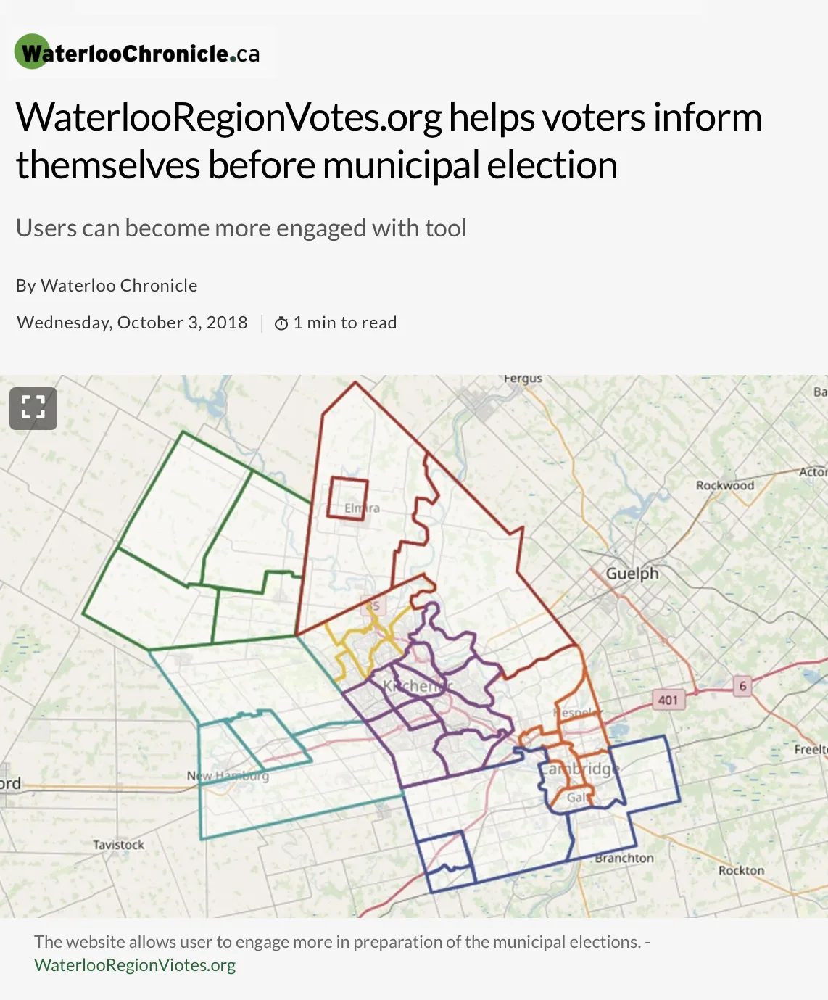

The original article on Waterloo Chronicle's website: [article link](https://www.waterloochronicle.ca/opinion/contributors/waterlooregionvotes-org-helps-voters-inform-themselves-before-municipal-election/article_ffb8304b-8c68-5a83-ac9b-29fc47877c48.html?)
