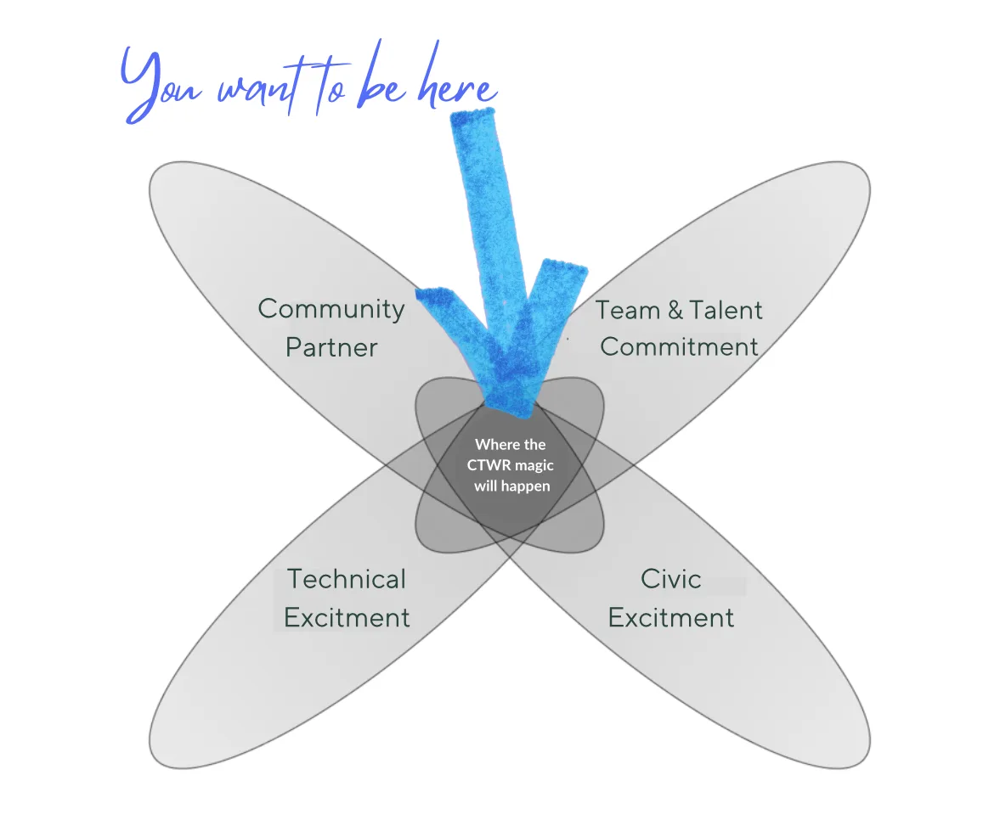
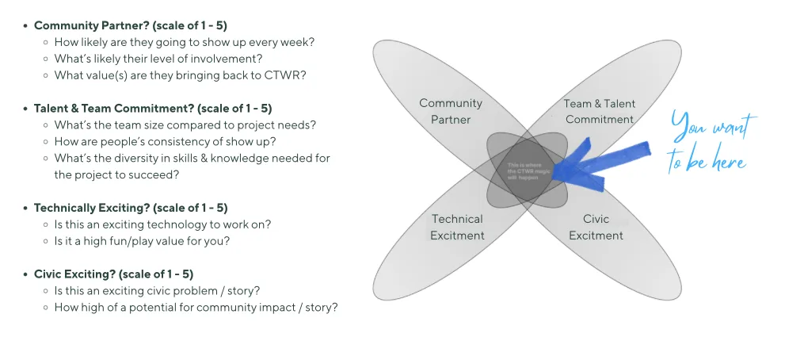
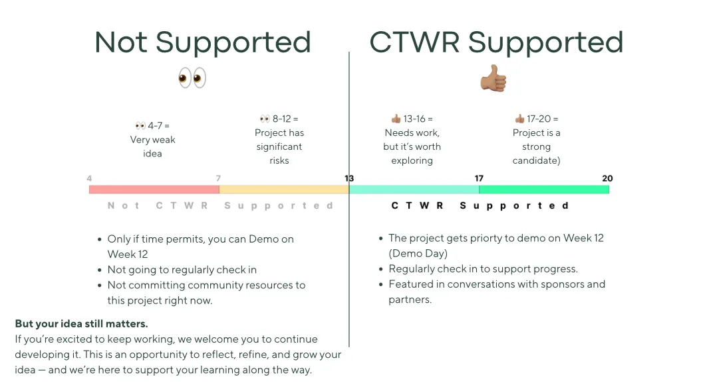
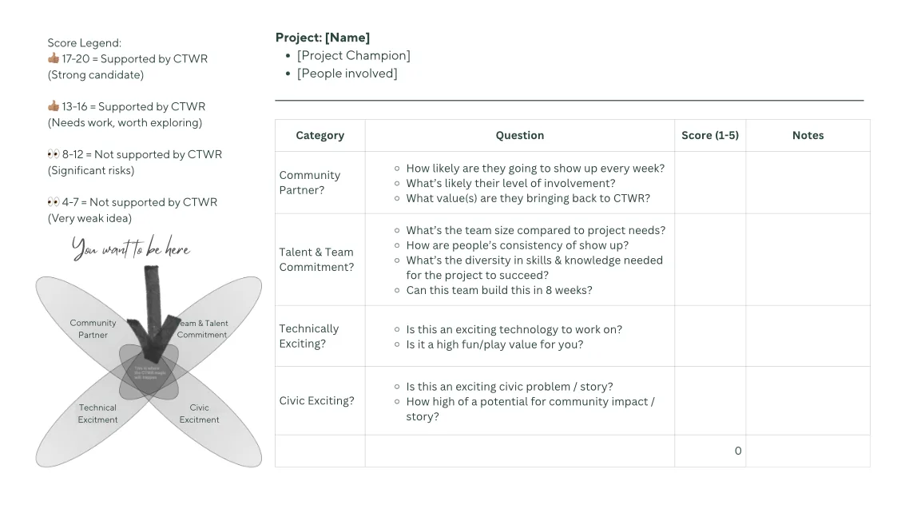

Civic tech ideas don’t fail for lack of enthusiasm—they fail when the community and the team can’t reliably show up. That’s why we re-worked IDEO’s classic DVF lens into a lightweight **20-point scorecard** built for CivicTechWR projects, where the “product” is often a public good and the fuel is volunteers. The goal: help teams decide **what to back, how much to back it, and what to learn next**—fast.

## Background info (for the unfamilar)

Years ago a design agency called IDEO came up with a framework called DVF (Desirability, Viability, Feasibility) as a simple three-lens check — used in design thinking to judge whether an idea is worth pursuing. *Desirability* asks if real people actually want it and whether it solves a meaningful problem. *Viability* tests if the idea can be sustained (funding, partners, policy, long-term stewardship). *Feasibility* examines whether we can build and operate it with today’s technology and constraints. Teams apply DVF early and often to surface risks, compare options, and shape lean experiments; our re-work keeps the spirit but adapts it to civic-tech realities.

## The four lenses we actually need

We adapted IDEO’s DVF into a four-lens rubric tailored to civic tech, putting people and public impact front and center. The lenses—Community Partner (consistent participation and value back to CTWR), Talent & Team Commitment (right skills, diversity, and weekly cadence), Technically Exciting (real maker energy), and Civic Exciting (a compelling public-interest story with visible impact)—turn the classic triad into an actionable 20-point scorecard.

Score each 1–5:

1. **Community Partner**
   Will partners consistently participate and bring real value back to the CTWR community?

2. **Talent & Team Commitment**
   Is the team sized, skilled, diverse—and able to show up weekly?

3. **Technically Exciting**
   Is there genuine maker energy here (new skills, playful learning, meaningful tech)?

4. **Civic Exciting**
   Is the public-interest story strong, with potential for visible community impact?

**Total (max 20) → Action**

* **17–20** → CTWR-supported: regular check-ins, featured storytelling, Demo Day slot.
* **13–16** → Worth exploring: continue building with targeted coaching.
* **8–12** → Significant risks: proceed only if the team is eager to de-risk.
* **4–7** → Not supported right now: welcome to learn in public, but with minimal CTWR resources.

## What does the score mean?

The score puts you in one of two categories: CTWR Supported, or Not CTWR Supported (the names are a work in progress!)

CTWR Supported means:
- The project gets priority to demo on Week 12 (Demo Day)
- Regularly check in to support progress.
- Featured in conversations with sponsors and partners.

Not CTWR Supported:
- Only if time permits, you can Demo on Week 12
- Not going to regularly check in
- Not committing community resources to this project right now.
- *But your idea still matters.*
  - If you’re excited to keep working, we welcome you to continue developing it. This is an opportunity to reflect, refine, and grow your idea — and we’re here to support your learning along the way.

## Why tweak DVF at all?

The three neat circles can lull us into false certainty. DVF is easy to recite and hard to operationalize. Our scorecard surfaces two messy realities that make or break community projects: **people’s availability** and **stakeholder follow-through**. We also bake in a practical “agreeability” check—will decision-makers actually support this?—through the **Community Partner** and **Team Commitment** lenses.

## The two equations check

Any working initiative should satisfy both:

1. **Created Value > Captured Value** (participants get more benefit than they “pay”—often in time or trust).
2. **Captured Value ≥ Cost to Deliver** (the effort is sustainable).

In civic tech, “capture” might be *adoption by a partner*, *volunteer hours retained*, or *policy progress*. The rubric is a quick signal on whether those equations can hold before we sink months of energy.

## How to use it in the wild

* **Run the score in Weeks 1 - 3**, it helps to run it as a community, so you can have critique that can help you. Then run the score again in Week 6 (as a mid-season check, to see where you are as a team / project). Aim for tracking movement, not perfection.
* For scores **≤12**, choose one risk to crush next (e.g., secure a named champion or recruit a missing skill).
* For **13–16**, scope a public demo to learn in front of users.
* For **17–20**, lean into momentum—tight cadences, regular showcases, strong storytelling with partners.

Design thinking still matters; we just made it **decision-ready** for volunteers, public partners, and the rhythm of meetups. If a project can’t earn committed people and a compelling civic story, it won’t matter how elegant the prototype is. If it can, this simple 20-point gut-check gives everyone permission to move—and keep learning together.

---

### Further reading

* IDEO: Design Thinking — [https://www.ideou.com/pages/design-thinking](https://www.ideou.com/pages/design-thinking)
* “DVF has become a self-defeating joke” — [https://credibleinnovation.com/dvf-has-become-a-self-defeating-joke/](https://credibleinnovation.com/dvf-has-become-a-self-defeating-joke/)
* Ash Maurya: The two equations to a working business — [https://www.linkedin.com/posts/ashmaurya\_there-are-two-equations-to-a-working-business-activity-7180901824600719360-7n5y/](https://www.linkedin.com/posts/ashmaurya_there-are-two-equations-to-a-working-business-activity-7180901824600719360-7n5y/)
* “The Law of the Diva” — [https://credibleinnovation.com/the-law-of-the-diva/](https://credibleinnovation.com/the-law-of-the-diva/)
